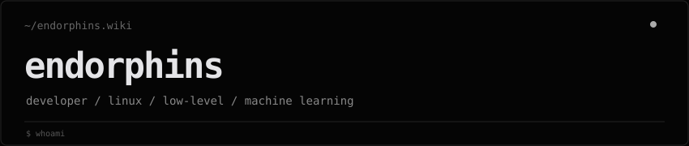
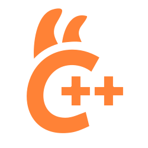

<pre>
$ whoami
endorphins

$ cat about.txt
building software, experimenting with linux, and exploring low-level systems & ai.
</pre>

<a href="https://endorphins.wiki">endorphins.wiki</a> · <a href="https://github.com/calebcat300-gif">github</a>

### status

### technologies

  
  
  
  
  
  
  
  
  
  
  
  
  
  
  
  
  
  
  
  
  
  
  
  
  
  
  
  
  
  
  
  
  
  
  
  
  
  
  
  
  
  
  
  
  
  

worked with · hover over an icon to inspect

---

<code>~/endorphins.wiki</code> · built to stay minimal
